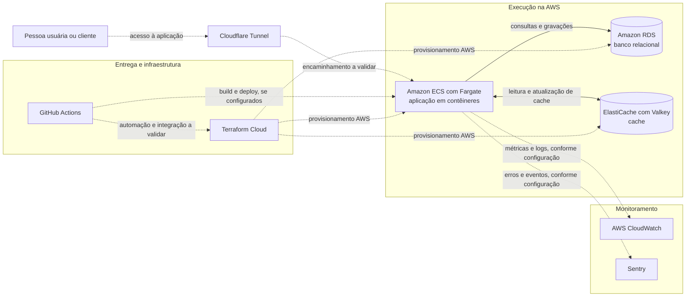

# Infraestrutura

Esta documentação descreve a infraestrutura utilizada pela plataforma **Lacrei Saúde**, incluindo serviços da AWS, ferramentas de automação e monitoramento, além de fluxos de integração e entrega contínua (CI/CD).

## Visão geral

A plataforma utiliza serviços da AWS para executar a aplicação e armazenar dados, além de ferramentas para automatizar a infraestrutura e acompanhar a operação:

- **Amazon ECS com AWS Fargate:** permite a execução de aplicações em contêineres sem administrar diretamente os servidores.
- **Amazon RDS:** serviço gerenciador de banco de dados relacional.
- **Amazon ElastiCache com Valkey:** cache em memória para dados que precisam de acesso rápido.
- **Cloudflare Tunnel:** componente relacionado ao acesso entre a rede Cloudflare e serviços da infraestrutura.
- **Terraform Cloud e GitHub Actions:** ferramentas de infraestrutura como código e automação de fluxos de desenvolvimento (CI/CD).
- **AWS CloudWatch e Sentry:** monitoramento e registro de erros, conforme o componente e o ambiente.

> ❓ **Requer revisão:** fluxo abaixo precisa ser confirmado com a equipe. O diagrama abaixo é uma representação conceitual da infraestrutura e dos serviços utilizados, mas não detalha todas as integrações e dependências.

## Detalhes dos serviços

> ❓ **Requer revisão:** verificar com a equipe se há detalhes adicionais sobre cada serviço, como configurações específicas, credenciais e políticas de segurança. Exemplos:
>
> - Como acessar o console da AWS e quais permissões são necessárias;
> - Quais serviços passam pelo Cloudflare Tunnel e quais não passam;
> - Quais métricas, logs e eventos são enviados ao CloudWatch e ao Sentry;
> - Quais workflows do GitHub Actions estão configurados e quais gatilhos acionam.
