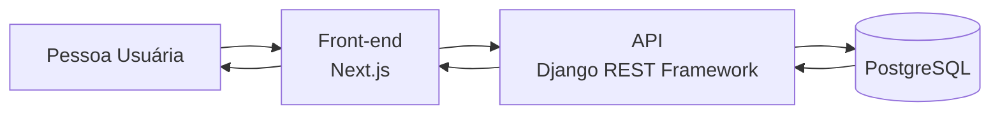

# Consultar perfis de profissionais da saúde

## Visão geral

Esta documentação descreve o fluxo de **consulta e visualização de perfis de profissionais da saúde**. O fluxo atende pessoas que acessam a **Lacrei Saúde** em busca de profissionais disponíveis na plataforma, permitindo que acessem informações relevantes sobre o atendimento.

O objetivo é detalhar como a interface se comunica com a API para recuperar e apresentar informações de profissionais disponíveis na plataforma.

## Fluxo da API

1. Pessoa usuária acessa a página de profissionais da saúde.
1. Front-end faz uma requisição de dados por meio de uma requisição HTTP para a API.
1. API processa a requisição e faz uma consulta dos dados necessários no PostgreSQL.
1. O PostgreSQL retorna as informações solicitadas.
1. A API devolve uma resposta estruturada em JSON.
1. O front-end renderiza os perfis disponíveis para a pessoa usuária.

> ❓ **Requer revisão:** complementar com:
>
> - Possíveis fluxos alternativos, como erros de comunicação, ausência de resultados (empty state), etc.
> - Detalhar se há paginação, pesquisa, filtros (exemplo: por especialidade médica) e se o acesso aos perfis é público ou autenticado.

## Contrato da API (Reference Endpoints)

- [Contrato da API](api-reference.md)
